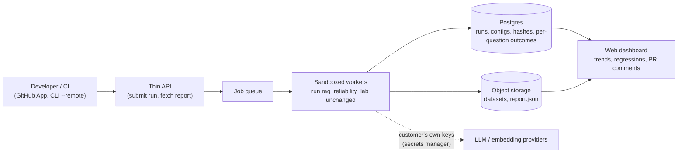

# Architecture

## Evaluation pipeline (Milestone 1, implemented)

```mermaid
flowchart LR
    subgraph Inputs["Version-controlled inputs"]
        CFG["configs/*.toml<br/>(strict, hashed)"]
        DS["datasets/&lt;name&gt;/<br/>corpus/ + questions.jsonl<br/>(span-level evidence)"]
    end

    subgraph Lab["rag_reliability_lab"]
        VAL["dataset.py<br/>validate: quotes exist once,<br/>facts grounded, gaps proven"]
        ING["ingest.py<br/>recursive, sorted discovery<br/>+ issue report"]
        CH["chunking.py<br/>recursive splitter<br/>(LangChain parity, exact offsets)"]
        RET{{"retrieval/<br/>BM25 · dense (opt.)"}}
        GEN{{"generation/<br/>extractive · Gemini (opt.) · none"}}
        RM["metrics/retrieval.py<br/>P@k R@k MRR hit complete"]
        AM["metrics/answer.py<br/>facts · abstention · citations<br/>· support · stale"]
        DIAG["runner.diagnose<br/>first failing stage"]
        REP["report.py<br/>JSON (source of truth)<br/>→ Markdown"]
    end

    CLI["cli.py: rag-lab<br/>validate-dataset · eval · report · show"]

    DS --> VAL --> ING --> CH --> RET --> GEN
    CFG --> CLI --> VAL
    RET -- top-k + deeper cutoffs --> RM
    GEN -- answer text --> AM
    RM --> DIAG
    AM --> DIAG --> REP
    REP --> OUT["reports/&lt;run&gt;/report.json<br/>reports/&lt;run&gt;/report.md"]
```

Retrieval is scored before generation sees anything, and answers are scored against the same evidence spans. That is how every failure gets attributed to one stage (`docs/SCORING.md` §4).

### Module map

| Module | Responsibility | Dependencies |
|---|---|---|
| `config.py` | TOML → frozen dataclasses. Rejects unknown keys and bad types/ranges. `sha256()` over the canonical config | stdlib |
| `dataset.py` | Dataset schema, loading, validation (`DatasetError` lists every problem) | stdlib |
| `ingest.py` | File discovery, UTF-8 text and per-page PDF loading, `IngestIssue` reporting, corpus fingerprint | `pypdf` |
| `chunking.py` | `RecursiveCharacterSplitter`: identical chunk texts to LangChain, offsets tracked exactly | stdlib |
| `text.py` | Normalisation, retrieval tokens, match tokens, sentence splitting | stdlib |
| `retrieval/bm25.py` | Okapi BM25 (Lucene IDF), deterministic ties | stdlib |
| `retrieval/dense.py` | Exact vector search (L2 / cosine / dot) over sentence-transformers embeddings | `numpy`, `sentence-transformers` (extra `dense`) |
| `generation/__init__.py` | Generator protocol, grounded prompt (`grounded-qa-v1`, hashed), refusal sentence | stdlib |
| `generation/extractive.py` | Deterministic sentence-extraction baseline | stdlib |
| `generation/gemini.py` | Gemini via `google-genai`: timeouts, bounded retries for 408/429/5xx and transport errors, typed failures | `google-genai` (extra `gemini`) |
| `metrics/*` | Retrieval and answer metrics, citation and abstention parsing, Wilson and bootstrap intervals | stdlib |
| `runner.py` | Orchestration with per-question error isolation, latency capture, diagnosis | stdlib |
| `report.py` | JSON report (deterministic except `environment` and `latency_ms`) and Markdown rendering | stdlib |
| `cli.py` | `rag-lab` entry point; exit codes 0 / 1 (invalid input) / 2 (question errors) | stdlib |

### Design decisions

- **No LangChain in the core.** The legacy pipeline's only LangChain logic that matters for evaluation is the text splitter. It is re-implemented, and a parity test checks it against LangChain on real and random text (identical chunk texts across 7 configurations). Leaving the framework out keeps the deterministic path to a single runtime dependency (`pypdf`). Its search-based `start_index` also produced backward offsets on degenerate input, which evidence matching cannot tolerate.
- **Span-level evidence.** Labels survive any chunking configuration, which is a prerequisite for comparing chunk sizes fairly.
- **JSON as the source of truth.** Markdown, and the planned Streamlit inspector, are renderings of `report.json`, so old reports can be re-rendered and diffed.
- **Exact search instead of FAISS for evaluation.** At evaluation scale brute force is exact and dependency-free. FAISS `IndexFlatL2`, which the legacy app used, is exact too, so the two produce the same rankings.
- **No database and no API server.** Nothing in the audited requirements needs concurrent users or shared state. Files plus git give versioning, review and reproducibility for free (see "future" below).
- **Offline by default.** The deterministic baseline needs no model download and no API key, so CI can run on every pull request at no cost.

## The legacy Q&A app (unchanged in Milestone 1)

`app.py` (index builder) and `streamlit_app.py` (UI) are kept as they were, apart from the `.dockerignore` rename. Their defects are documented in `PROJECT_AUDIT.md`, and the plan is to rebuild them on the lab's modules in Milestone 3.

## Possible future hosted service (not built, not needed yet)

A sketch of how the CLI could become a paid developer product without redesigning the core. **None of this exists in the repository.**

- The worker runs the same package and the same `report.json` schema. Nothing about scoring changes when hosted.
- Value added by hosting: history and trend charts per dataset and config hash, regression alerts, PR comments with paired-significance deltas, shared datasets per team, and managed embedding caches.
- Tenancy: per-organisation storage prefixes and database row-level security. Model keys stay with the customer (bring your own keys), so the service never pays for or stores inference.
- What would justify building it: several teams needing shared history, or CI gates across repositories. Until then the CLI plus CI artifacts cover the need.
